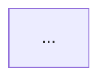

# Mermaid conventions for mermaid-mapper

## Default graph direction

The **aggregation** step wraps the final diagram as:



Individual mapper outputs are **edge lines only**; do not emit `graph TD` or closing fences in mapper partials.

## Edge syntax

| Relationship | Syntax |
| --- | --- |
| Inheritance | `Child --|> Base` |
| Composition or direct dependency | `A --> B` |

Use node identifiers that match the C# type names being mapped (no generic noise in node IDs when avoidable).

## Style rules (v1)

- Prefer a **correct, stable** graph over decorative layout.
- **No** `style`, `classDef`, or theme overrides.
- **No** subgraphs in v1 unless the relationship is obvious from file-local structure and adds no guesswork.

## Mapper partial content

Mappers output **only** lines that belong inside the `graph TD` body, for example:

```text
WoodViewModel --> ResourceInventoryViewModel
EliteResourceViewModel --|> ResourceViewModel
```

- No markdown prose before or after.
- No fenced code blocks in partials.
- No comments unless the user explicitly asked for annotated output in a non-workflow run.

## Aggregation responsibility

The **mermaid-aggregation** skill adds the `graph TD` wrapper and wraps the body in one markdown fenced code block labeled `mermaid` when writing `mermaid.md`.
